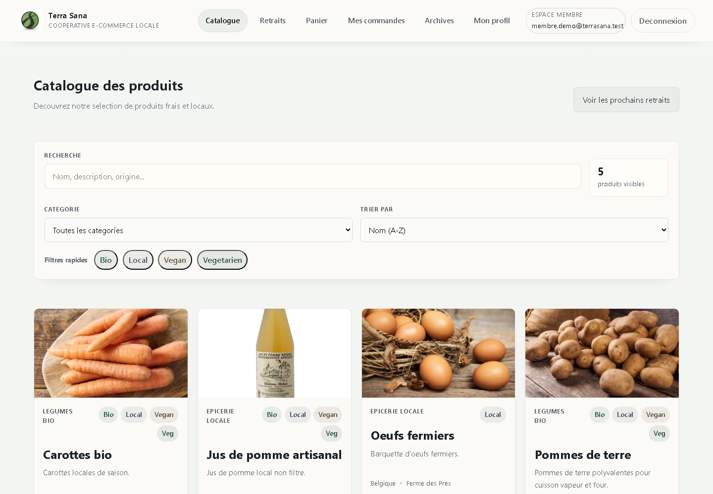
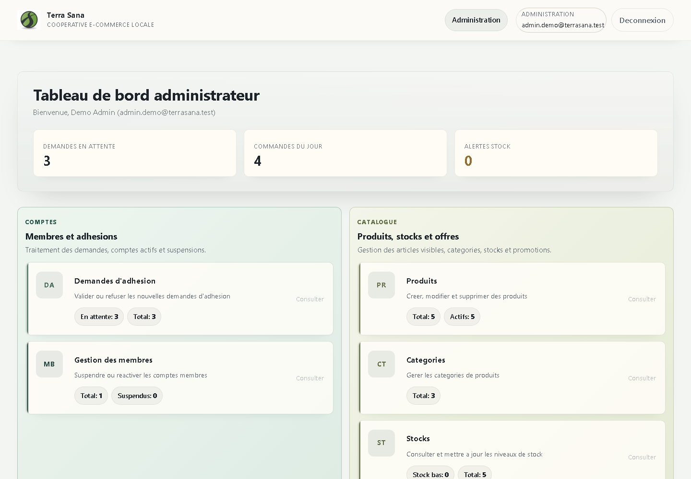
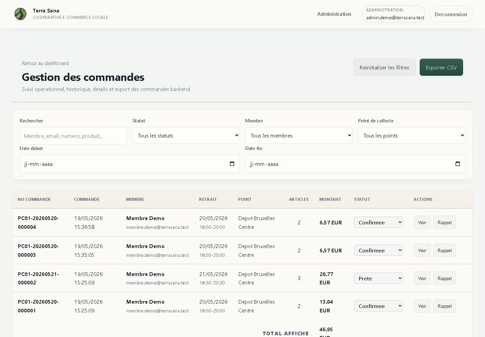
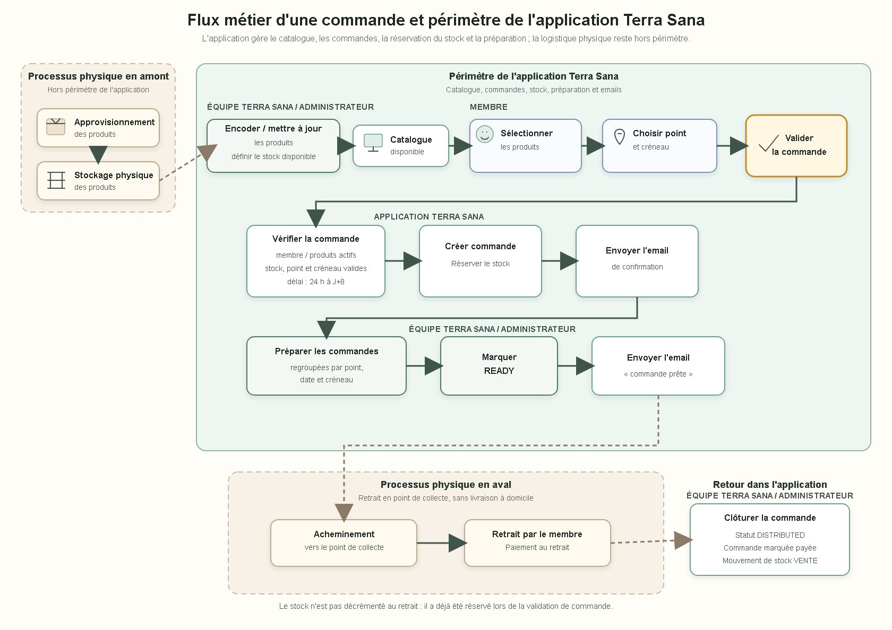

# Terra Sana

[](https://github.com/safouanfr-arch/terra-sana/actions/workflows/ci.yml)

An e-commerce application for a local food cooperative. It manages membership, product orders, stock and collection slots.


## Overview

- **Members** can sign in, browse products, manage a cart, choose a pickup point and time, and place, cancel or track orders.
- **Administrators** manage memberships, products, stock, orders, promotions, collections, exports and email notifications.

The backend enforces prices, availability, access control, stock reservations and order state transitions.

## Technical features

- Spring Security session authentication with `MEMBRE` and `ADMIN` roles, BCrypt, session fixation protection and CSRF protection.
- REST responses distinguish unauthenticated requests (`401`) from forbidden requests (`403`).
- Orders can be placed between 24 hours and eight days before pickup. Pessimistic product locking and a JPA `@Version` field help handle concurrent updates.
- The stock journal records reservations, cancellations, sales and adjustments. The backend calculates product and category promotions.
- SMTP deliveries are recorded as `PENDING`, `SENT` or `FAILED`. The scheduled pickup reminder runs the day before pickup and avoids duplicate sends.
- The local demo uses file-backed H2. Tests use an isolated in-memory H2 database. CSV exports support spreadsheet software configured for French locales.

| Area | Technologies |
| --- | --- |
| Frontend | Vue 3, Vite, Pinia, Vue Router, Axios |
| Backend | Java 17, Spring Boot 4.0.10, Spring Security, Spring Data JPA |
| Data | Hibernate, H2 |
| Testing and CI | JUnit 5, Mockito, AssertJ, Gradle, GitHub Actions |

## Architecture


The Vue frontend calls a JSON REST API using a session cookie. Controllers delegate to domain services backed by JPA repositories. SMTP delivery failures are recorded while the associated business operation continues. See the [security review](docs/security-review.md) and [Spring Boot migration notes](docs/spring-boot-migration.md).

| Member catalogue | Admin dashboard |
| --- | --- |
|  |  |

| Order management | Order workflow |
| --- | --- |
|  |  |

## Run locally

Use JDK 17 or newer and Node.js 22.12 or newer.

### Backend

```powershell
cd "Back End Java"
./gradlew.bat bootRun
```

The API runs at `http://localhost:8081`. The `dev` profile binds to loopback and creates the local database under `Back End Java/data/`. Select `prod` explicitly when using a prepared database and configure the frontend origin and HTTPS. State-changing API requests require the session token returned by `GET /api/auth/csrf`. The Vue client handles this exchange.

### Frontend

In a second terminal from the repository root:

```powershell
cd "Front End VUE3"
npm ci
npm run dev
```

Open `http://localhost:5173`. The default backend URL is `http://localhost:8081/api`. To change it, copy `.env.example` to `.env` and set `VITE_API_BASE_URL`.

### Windows shortcuts

```powershell
powershell -ExecutionPolicy Bypass -File .\launcher\Install-DesktopShortcuts.ps1
```

The `Terra Sana` shortcut starts both services and opens the application. The `Arrêter Terra Sana` shortcut stops the processes it started. Startup logs are stored in `.terra-sana-runtime/`.

### Optional SMTP and scheduling

Email sending is disabled by default. For local use, copy `config/application-secrets.example.properties` to `config/application-secrets.properties` in the backend folder. Set `spring.mail.host`, `spring.mail.port`, `spring.mail.username`, `spring.mail.password`, `app.mail.from` and `app.mail.enabled=true`. Keep this local settings file outside version control.

`TERRA_SANA_PREPARATION_EMAIL` sets the recipient of the automated preparation PDF. Without a recipient, automatic sending of that PDF is skipped.

- `app.order-preparation.enabled` and `app.order-preparation.cron` control the transition to preparation 24 hours before pickup.
- `app.order-reminder.enabled` and `app.order-reminder.cron` control the day-before reminder.
- Both tasks use the `Europe/Brussels` time zone.

## Tests and builds

```powershell
cd "Back End Java"
./gradlew.bat test
./gradlew.bat build

cd "../Front End VUE3"
npm ci
npm run build
```

GitHub Actions runs the backend tests and builds the backend and frontend on pushes and pull requests.

## Project scope

This graduation project demonstrates end-to-end local operation. Online payments, production deployment and transport logistics are outside its scope.
