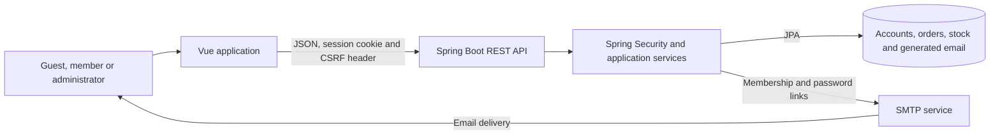

# Terra Sana security review

This review compares the published `fadfa86` baseline with the proposed hardening branch. It covers the repository and local test environment. Production configuration, reverse proxies, live mail delivery and operational monitoring require separate verification.

## Architecture and trust boundaries

The browser, API, database and SMTP service have separate trust boundaries. Protect session IDs, passwords, reset links, member contact details, orders and generated email. Guests can submit public membership and reset requests. Members access their own orders. Administrators manage catalogues, orders, memberships, pickup and notifications.

The API creates an HTTP session after sign-in. The proposed branch also uses the session to bind a CSRF token to the browser. Spring Security provides the token through `GET /api/auth/csrf`. The Vue HTTP client fetches it for each mutation and sends it in the response-specified request header. Successful login rotates the session identifier and clears the pre-authentication CSRF token. Logout invalidates the session. [Security configuration](../Back%20End%20Java/src/main/java/com/example/demo/config/SecurityConfig.java) · [Authentication controller](../Back%20End%20Java/src/main/java/com/example/demo/controller/AuthController.java) · [Vue API client](../Front%20End%20VUE3/src/services/api.js)

## STRIDE threat model

| Threat | Example in this application | Control or treatment |
| --- | --- | --- |
| Spoofing | Stolen session, guessed password or forwarded reset link | BCrypt, session ID rotation, cookie-only session tracking, HTTPS and Secure cookies in the production profile. Add rate limits and session revocation. |
| Tampering | Cross-site mutation or an attempt to cancel another member’s order | Token validation on unsafe HTTP methods, ordered role rules and a service-level order owner check. |
| Repudiation | A disputed stock, membership or administrative change | Business records exist. Add consistent security events with actor, action, timestamp, outcome and request ID. |
| Information disclosure | H2 console access, verbose SQL logs, exposed reset links or user records | Disable the console and SQL statement logging. Limit administration, logs and database access. Review generated email retention. |
| Denial of service | Repeated sign-in, reset or expensive email/PDF requests | Membership operations already have local rate limits. Add deployment-level throttling and monitor mail and database capacity. |
| Elevation of privilege | Role bypass through a new unmapped API route or stale sessions after a suspension | Deny unmatched API routes and test role boundaries. Revalidate privileges or revoke sessions on account changes. |

## Risk register

Priority estimates consider impact and the preconditions for a reachable deployment. A proposed change remains pending until review and deployment.

| ID | Priority | Baseline finding and evidence | Proposed treatment and residual risk |
| --- | --- | --- | --- |
| TS-01 | High | Session-authenticated writes were accepted without CSRF validation. CORS alone did not protect browser form submissions. | Enable session-bound CSRF for all unsafe methods, including login and public mutations. Client and API must be released together. |
| TS-02 | High | Base properties enabled H2 Console and the security chain allowed anonymous access to its default path. | Disable the servlet by default and deny the default routes even if the console is accidentally enabled. Use local database tools for development diagnostics. |
| TS-03 | High | Default database initialization and demo seeding were coupled to normal startup, with the development listener and credentials also used by default. | Keep the existing local demo under a loopback-only `dev` profile and require explicit database settings under `prod`. Review the database and TLS configuration before deployment. |
| TS-04 | Medium | Base configuration enabled SQL statement logging. Generated email records and ordinary application logs can also include sensitive data. | Switch SQL statements off. Set a retention policy, restrict exports and log access, and avoid storing live recovery links beyond delivery. |
| TS-05 | Medium | Login already changed an existing session ID and logout invalidated the current session. Active accounts and roles are kept in the principal for the life of the session. | Set explicit HttpOnly, SameSite=Lax, cookie-only tracking and a 30-minute idle timeout. Set Secure under `prod`. Other sessions can remain active after resets, password changes or suspension. |
| TS-06 | High | Password setup and recovery use a random token hashed in the member record, a 24-hour lifetime and clearing on successful use. The completion path performs a read followed by an update. The raw link is used in generated email. | Keep onboarding functional. Shorten expiry independently of onboarding, consume the token atomically, remove live links from retained email, and verify that pre-suspension links cannot reactivate accounts. |
| TS-07 | Medium | Reset returns a generic message, but reset and login lack the membership-specific rate limiter. Disabled accounts are checked before password validation. A legacy password migration path still accepts older storage formats. | Rate-limit by account and client at a trusted edge, monitor abuse, review response consistency and retire legacy password storage after migration. |
| TS-08 | Medium | Orders are created and listed using the authenticated member ID. Member cancellation checks the order owner, and admin operations have route-based role enforcement. Unknown API paths previously fell back to authenticated access. | Keep object ownership enforcement and require an explicit role for cancellation. Deny unmatched API paths. Add negative ownership coverage for every future ID-based member route. |
| TS-09 | High | OSV returned advisories for 16 of 75 resolved Maven artifacts. Matches include Spring Security, Spring MVC, embedded Tomcat, Jackson and Logback. Applicability depends on the component and enabled features. | Move to a supported Spring Boot line and rescan the resolved dependency graph before deployment. Track reachable advisories and transitive pins separately. |
| TS-10 | Review | The repository root has no explicit project license. Runtime dependencies and product images have their own provenance and terms. | Confirm reuse terms for the project and image assets before further redistribution. |

## Code references

- Session, role and CORS rules are in [SecurityConfig.java](../Back%20End%20Java/src/main/java/com/example/demo/config/SecurityConfig.java). The order controller derives principal IDs from the security context, and cancellation delegates to the service owner check. [CommandeController.java](../Back%20End%20Java/src/main/java/com/example/demo/controller/CommandeController.java) · [CommandeService.java](../Back%20End%20Java/src/main/java/com/example/demo/service/CommandeService.java)
- Password reset, legacy password migration and account activation are implemented in the authentication service. Random generation and hashing are in the token service. Generated emails can retain rendered links. [AuthService.java](../Back%20End%20Java/src/main/java/com/example/demo/service/AuthService.java) · [PasswordTokenService.java](../Back%20End%20Java/src/main/java/com/example/demo/service/PasswordTokenService.java) · [GeneratedEmailService.java](../Back%20End%20Java/src/main/java/com/example/demo/service/GeneratedEmailService.java)
- Default, development and production settings are tracked separately. The development SMTP override is ignored by Git. Production requires externally managed secrets and a provisioned schema. [Defaults](../Back%20End%20Java/src/main/resources/application.properties) · [Development](../Back%20End%20Java/src/main/resources/application-dev.properties) · [Production](../Back%20End%20Java/src/main/resources/application-prod.properties)

## Verification

The baseline passed 187 backend tests and produced the backend JAR and Vue production bundle. The proposed branch passed 190 backend tests and both builds. The security tests verify missing CSRF rejection, a real session-bound header, H2 denial, untrusted origins and CSRF invalidation on sign-in. Existing permission, stock, membership and reset tests still exercise their original business assertions with valid CSRF tokens.

Reproduce with `gradlew test bootJar` in the backend and `npm ci` followed by `npm run build` in the frontend. An HTTP smoke test against the built JAR confirmed the bootstrap endpoint, local trusted origin, HttpOnly and SameSite=Lax flags, rejection of a login POST without the token, and denial of H2 access. The smoke test used loopback, an in-memory database and disabled email. A browser smoke test with a trusted HTTPS deployment remains necessary to exercise proxy, origin and cookie behavior together.

### Dependencies and history

The npm audit returned zero published advisories for the lockfile at review time. The Gradle `runtimeClasspath` was resolved and submitted to OSV using only publicly known package coordinates and versions. The branch retains the same dependency versions. Spring Boot 3.5.7 belongs to a line whose final open-source release was 3.5.16. A migration is a separate compatibility change. [OSV package query](https://google.github.io/osv.dev/post-v1-querybatch/) · [Spring Boot 3.5 support notice](https://spring.io/blog/2026/06/25/spring-boot-3-5-16-available-now/)

The local Git history scan inspected 350 text blobs using common provider signatures and configuration checks. The example secrets configuration was flagged for placeholder review. In this bounded scan, binary objects, large blobs and secrets that do not match the rules remain unverified.

## Deployment and residual risks

- Keep the development profile on loopback. Use matching hostnames for the local front and API so the browser accepts the session cookie. Point production builds at the intended API origin.
- Activate `prod` explicitly. Set `TERRA_SANA_DB_URL`, `TERRA_SANA_DB_USERNAME`, `TERRA_SANA_DB_PASSWORD` and `TERRA_SANA_FRONTEND_URL` securely. Provision and back up the database schema before startup. The repository bundles an H2 driver, and other database engines require driver and SQL compatibility testing. Review SMTP authentication and TLS before enabling delivery.
- Serve the frontend and API over HTTPS on the same site, preferably behind one origin. Set `TERRA_SANA_CORS_ORIGINS` only for a trusted frontend on a different origin. Validate proxy settings, cookie flags, rate limits and access logs. Reset URLs should be excluded from request logging and should not leak through referrers.
- Define account suspension and session revocation rules, run a controlled restore, and verify only authorized staff can access member data or generated email. This branch is a partial hardening proposal with these controls outstanding.

The token bootstrap follows the servlet approach documented by Spring Security. [Spring Security CSRF reference](https://docs.spring.io/spring-security/reference/servlet/exploits/csrf.html)
